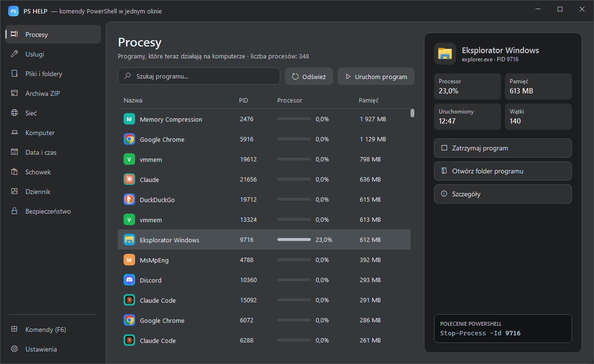
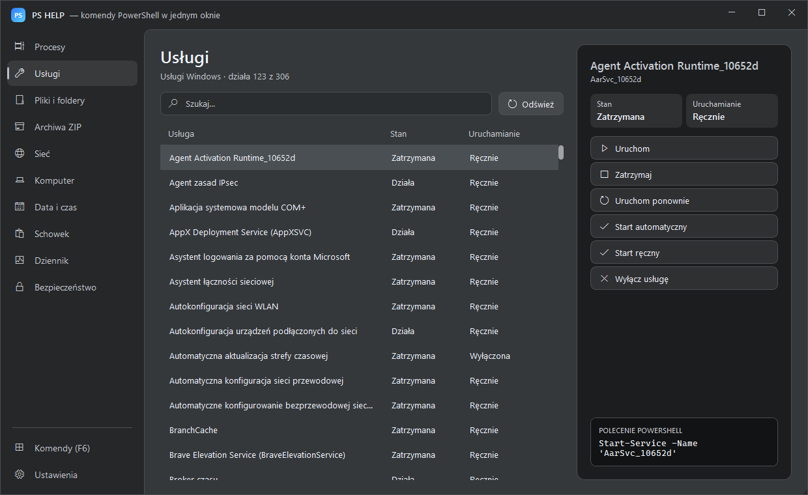
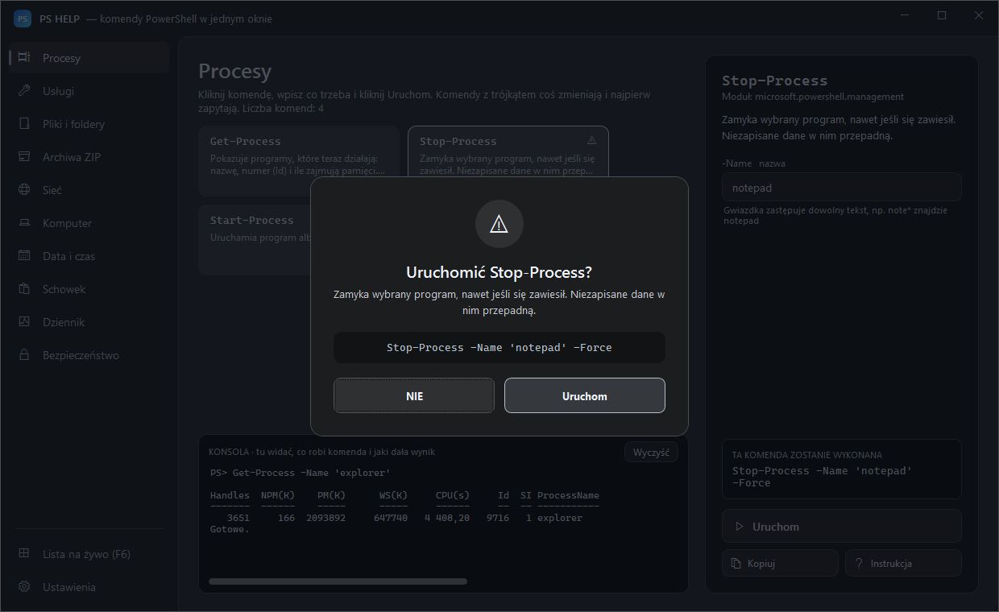
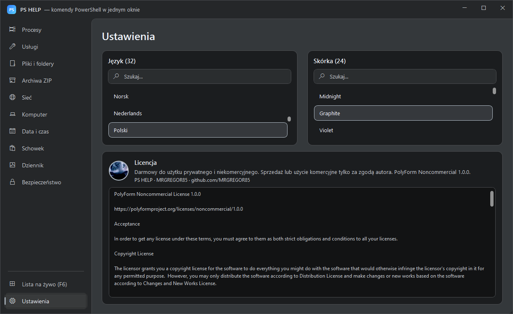

# PS HELP · Windows 10/11

## PowerShell commands in one window.

### Click instead of typing: 10 sections, 40+ commands, 24 skins and 32 languages in one portable program for Windows.

**Windows 10 and 11 · one .exe file, no installer**

## [🇬🇧 English](README.md) &nbsp; [🇵🇱 Polski](README_PL.md) &nbsp; [🇩🇪 Deutsch](lang/README_DE.md) &nbsp; [🇨🇿 Čeština](lang/README_CS.md) &nbsp; [🇸🇰 Slovenčina](lang/README_SK.md) &nbsp; [🇺🇦 Українська](lang/README_UK.md) &nbsp; [🇷🇺 Русский](lang/README_RU.md) &nbsp; [🇱🇹 Lietuvių](lang/README_LT.md) &nbsp; [🇱🇻 Latviešu](lang/README_LV.md) &nbsp; [🇪🇪 Eesti](lang/README_ET.md) &nbsp; [🇪🇸 Español](lang/README_ES.md) &nbsp; [🇫🇷 Français](lang/README_FR.md) &nbsp; [🇮🇹 Italiano](lang/README_IT.md) &nbsp; [🇵🇹 Português](lang/README_PT.md) &nbsp; [🇳🇱 Nederlands](lang/README_NL.md) &nbsp; [🇸🇪 Svenska](lang/README_SV.md) &nbsp; [🇩🇰 Dansk](lang/README_DA.md) &nbsp; [🇳🇴 Norsk](lang/README_NB.md) &nbsp; [🇫🇮 Suomi](lang/README_FI.md) &nbsp; [🇭🇺 Magyar](lang/README_HU.md) &nbsp; [🇷🇴 Română](lang/README_RO.md) &nbsp; [🇧🇬 Български](lang/README_BG.md) &nbsp; [🇬🇷 Ελληνικά](lang/README_EL.md) &nbsp; [🇭🇷 Hrvatski](lang/README_HR.md) &nbsp; [🇷🇸 Srpski](lang/README_SR.md) &nbsp; [🇸🇮 Slovenščina](lang/README_SL.md) &nbsp; [🇹🇷 Türkçe](lang/README_TR.md) &nbsp; [🇻🇳 Tiếng Việt](lang/README_VI.md) &nbsp; [🇮🇩 Indonesia](lang/README_ID.md) &nbsp; [🇯🇵 日本語](lang/README_JA.md) &nbsp; [🇰🇷 한국어](lang/README_KO.md) &nbsp; [🇨🇳 中文](lang/README_ZH.md)

[Screenshots](#-screenshots) · [YouTube](#-youtube) · [License](LICENSE) · [Issues](https://github.com/MRGREGOR85/PS-HELP-/issues)

---

<table>
<tr>
<td valign="top" width="240">

### Menu

- [What is it?](#-what-is-it)
- [Quick start](#-quick-start)
- [Features](#-features)
- [Screenshots](#-screenshots)
- [All sections](#-all-sections)
- [Skins](#-skins)
- [Languages](#-languages)
- [Something not working?](#-something-not-working)
- [Is it safe?](#-is-it-safe)
- [YouTube](#-youtube)
- [License](#-license)

</td>
<td valign="top">

## 💡 What is it?

### PS HELP turns PowerShell commands into an ordinary window with lists and buttons.

You don't need to know any commands by heart or type anything into a black console. Click a section on the left, then an item in the list and a button with an action. Every button runs a **real PowerShell command**, and the program always shows exactly which one at the bottom of the window, so you learn PowerShell along the way.

Everything happens in one window: no pop-ups and no black console in the background. The program sends nothing to the internet, and your settings stay on your computer.

</td>
</tr>
</table>

## 🚀 Quick start

**1.** **Download** the package from [Releases](https://github.com/MRGREGOR85/PS-HELP-/releases/latest) and unzip it anywhere, for example to your desktop.  
**2.** **Run** `PS HELP.exe` with a double click. No black console appears, the program hides it. On the first start Windows may warn you through SmartScreen: **More info → Run anyway**.  
**3.** **Pick a section on the left.** The menu has ten sections and **Settings** at the bottom.  
**4.** **Click an item** in the list. Details and action buttons appear on the right, and the **POWERSHELL COMMAND** box shows the command the button will run.

**5.** **Confirm the change.** Everything that changes something shows the full command and waits for **YES** or **NO**.

**6.** **Set language and skin** in **Settings**. They save themselves and wait for you on the next start.

**You need:** Windows 10 or 11 · Windows PowerShell 5.1 (included in every Windows 10/11) · administrator rights only for some changes: services, time zone, date and script execution policy.

| File in the package | What it is for |
|---|---|
| `PS HELP.exe` | The whole program in one file: starts PS HELP, also runs from a USB stick |
| `PS_HELP.ico` | The program icon |
| `LICENSE` | The program license |

> 💡 The program files unpack themselves into a hidden `app` folder. You never need to look there or change anything.

## ✨ Features

| Feature | What it means |
|---|---|
| **10 sections** | Processes, services, files and folders, ZIP archives, network, computer, date and time, clipboard, event log, security |
| **40+ commands** | Real PowerShell commands behind the buttons, each shown before it runs |
| **Command preview** | The command a button will run is always visible at the bottom of the window |
| **YES / NO question** | Everything that changes something asks first and shows the full command |
| **24 skins** | From dark Graphite through Hacker Green to light Snow White |
| **32 languages** | The whole interface switches instantly, the commands stay the same |
| **No installation** | Runs on the built-in Windows PowerShell 5.1, nothing to install |
| **One window** | No pop-up windows and no black console in the background |
| **Download with progress** | Bar, percent, speed and time left, cancel at any moment |
| **Private** | Nothing is sent to the internet, settings stay on your computer |

## 📸 Screenshots

<table>
<tr>
<td width="50%"> <b>Main window</b>: Processes section with a live list</td>
<td width="50%"> <b>Services</b>: start, stop and restart in one click</td>
</tr>
<tr>
<td width="50%"> <b>YES / NO question</b>: the full command before every change</td>
<td width="50%"> <b>Settings</b>: 24 skins and 32 languages</td>
</tr>
</table>

## 🧭 All sections

### ⚙️ Processes

The list of programs running right now: name, PID, CPU with a bar and memory. It refreshes itself every 2 seconds. Search box, **Refresh**, **Run a program**. After clicking a program you see CPU, memory, start time and threads, plus the buttons **Close program**, **Open program folder** and **Details**.

Commands used: `Get-Process`, `Stop-Process`, `Start-Process`, `Wait-Process`

### 🔧 Services

Windows services with their state (running or stopped) and startup type. Actions: **Start**, **Stop**, **Restart**, **Automatic start**, **Manual start**, **Disable service**. Example: a stuck printer is the *Print Spooler* service → **Restart**.

Commands used: `Get-Service`, `Start-Service`, `Stop-Service`, `Restart-Service`, `Set-Service`

### 📁 Files and folders

A small explorer: **Folder** box, **Up**, **New folder**, **Empty Recycle Bin**. For a file: **Open**, **Copy to…**, **Move to…**, **Rename**, **Delete** (permanently, not to the Recycle Bin), **SHA256 checksum** and **Unblock file** downloaded from the internet.

Commands used: `Get-ChildItem`, `Copy-Item`, `Move-Item`, `Rename-Item`, `Remove-Item`, `New-Item`, `Test-Path`, `Invoke-Item`, `Get-FileHash`, `Unblock-File`, `Clear-RecycleBin`

### 🗜️ ZIP archives

Select a file or folder and click **Pack to ZIP**. Select a `.zip` file and click **Unpack ZIP**, and it lands in a folder with the same name. Large archives are packed in the background, the window doesn't freeze.

Commands used: `Compress-Archive`, `Expand-Archive`

### 🌐 Network

**Check connection** sends 4 pings with response time and status. **Download file** takes a link pasted with **Ctrl+V**; the bottom of the window shows a progress bar, percent, speed and time left, and **Stop download** stops it.

Commands used: `Test-Connection`, `Invoke-WebRequest`

### 🖥️ Computer

Computer name, Windows version, CPU, cores, total and free RAM, graphics card, free disk space, uptime, last boot and number of updates. You can copy any value to the clipboard. Buttons: **List of updates**, **Rename computer**, **Restart**, **Shut down**.

Commands used: `Get-ComputerInfo`, `Get-CimInstance`, `Get-HotFix`, `Get-Uptime`, `Get-PSDrive`, `Rename-Computer`, `Restart-Computer`, `Stop-Computer`

### 🕒 Date and time

Current date, time and time zone, plus a searchable list of all zones. **Set this zone** and **Set date and time** need administrator rights.

Commands used: `Get-Date`, `Set-Date`, `Get-TimeZone`, `Set-TimeZone`

### 📋 Clipboard

What is in the clipboard right now, line by line. **Copy this line**, or type text and click **Put in clipboard**.

Commands used: `Get-Clipboard`, `Set-Clipboard`

### 📜 Event log

The last 200 errors and warnings from the System and Application logs: time, level, source and description. **Full description** shows the whole text of the event.

Commands used: `Get-WinEvent`, `Get-Counter`

### 🔒 Security

The PowerShell script execution policy for every scope. For the user scope: **Allow scripts (RemoteSigned)**, **Block scripts (Restricted)**, **Clear setting (Undefined)**. **Who has access to a file** shows permissions, read only.

Commands used: `Get-ExecutionPolicy`, `Set-ExecutionPolicy`, `Get-Acl`

## 🎨 Skins

**Settings → Skin**. Click a name and the program changes colours instantly. There is a search box above the list, for example `blue`. All 24 skins are built into the program, and the one you pick is saved automatically.

Midnight · Graphite · Violet · Light · CMD HELP · Ghost Dark · Midnight Blue · Deep Ocean · Arctic Blue · Carbon Black · Silver Steel · Studio Light · Snow White · Emerald · Hacker Green · Forest · Neon Cyan · Cyber Purple · Royal Violet · Crimson · Ruby Red · Sunset Orange · Golden · Rose Pink

## 🌍 Languages

**Settings → Language**. The whole interface switches instantly, and the PowerShell commands stay the same. Available: Polish, English, German, Czech, Slovak, Ukrainian, Russian, Lithuanian, Latvian, Estonian, Spanish, French, Italian, Portuguese, Dutch, Swedish, Danish, Norwegian, Finnish, Hungarian, Romanian, Bulgarian, Greek, Croatian, Serbian, Slovenian, Turkish, Vietnamese, Indonesian, Japanese, Korean and Chinese.

## 🆘 Something not working?

| What I see | What to do |
|---|---|
| The window doesn't open | Check the file `%APPDATA%\PS HELP\startup-error.log` |
| "Access denied" | This change needs administrator rights |
| A command takes a long time | Click **Cancel command** in the console at the bottom of the window |
| I want to reset the settings | Delete the file `%APPDATA%\PS HELP\settings.json` |
| Antivirus or SmartScreen warns about `PS HELP.exe` | The file has no paid digital signature, and the whole program code is open in the `app` folder |

## 🔒 Is it safe?

### PS HELP uses only the built-in Windows PowerShell commands.

It sends no data to the internet, except what you ask for yourself, for example a ping or a download. Every change shows the full command and waits for **YES**. The whole program code is open in the `app` folder, and you can read it.

## 🎬 YouTube

[Watch the video guide on YouTube](https://youtu.be/QqdOe_s7X2A)

**Full video guide, about 24 minutes.** All ten sections live, the YES / NO question before every change, a download with a progress bar, 24 skins and 32 languages. Polish narration, 1080p.

## 📜 License

### PS HELP belongs solely to its author, MRGREGOR85. All rights reserved.

You may download the program only from this page and use it free of charge on your own computer, for private use. Without the author's written permission you may not share it with others, upload it anywhere else, sell it, modify it or rebuild it. Full text: [LICENSE](LICENSE). You can also read the license in the program: **Settings → License**.

## 👨‍💻 Author

### MRGREGOR85

[github.com/MRGREGOR85](https://github.com/MRGREGOR85) · [YouTube](https://www.youtube.com/@MRGREGOR85)

Have an idea or found a bug? Open a report in [Issues](https://github.com/MRGREGOR85/PS-HELP-/issues).

### If PS HELP helps you, leave a ⭐

