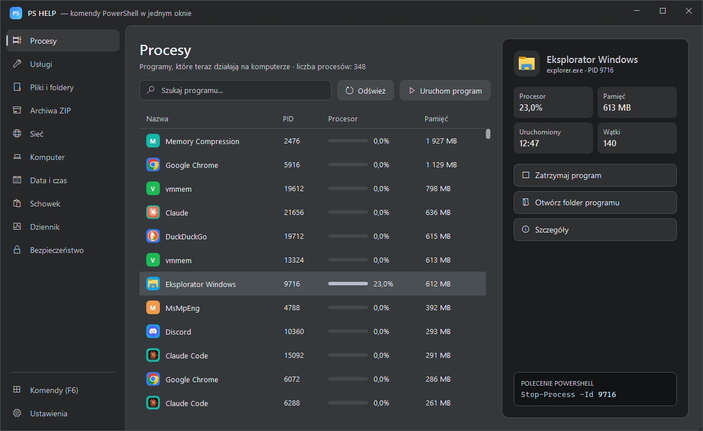
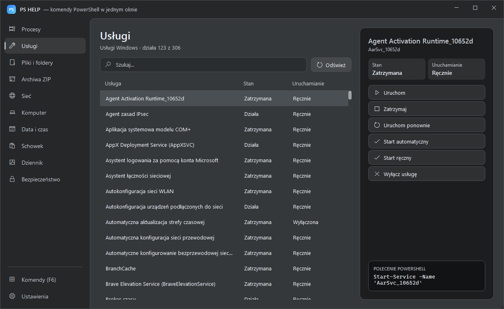
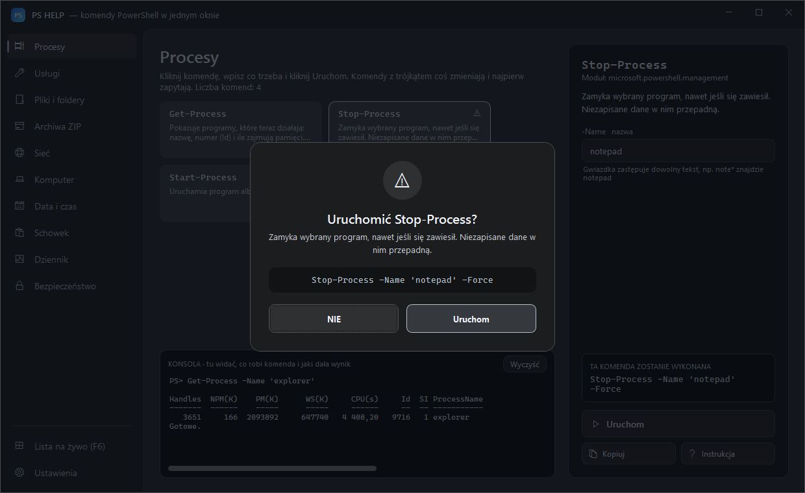
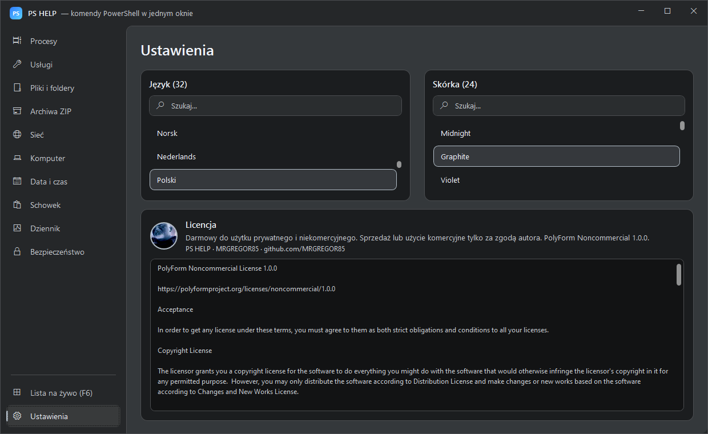

# PS HELP · Windows 10/11

## Komendy PowerShell w jednym oknie.

### Klikasz zamiast pisać: 10 działów, ponad 40 komend, 24 skórki i 32 języki w jednym przenośnym programie dla Windows.

**Windows 10 i 11 · jeden plik .exe, bez instalatora**

## [🇬🇧 English](README.md) &nbsp; [🇵🇱 Polski](README_PL.md) &nbsp; [🇩🇪 Deutsch](lang/README_DE.md) &nbsp; [🇨🇿 Čeština](lang/README_CS.md) &nbsp; [🇸🇰 Slovenčina](lang/README_SK.md) &nbsp; [🇺🇦 Українська](lang/README_UK.md) &nbsp; [🇷🇺 Русский](lang/README_RU.md) &nbsp; [🇱🇹 Lietuvių](lang/README_LT.md) &nbsp; [🇱🇻 Latviešu](lang/README_LV.md) &nbsp; [🇪🇪 Eesti](lang/README_ET.md) &nbsp; [🇪🇸 Español](lang/README_ES.md) &nbsp; [🇫🇷 Français](lang/README_FR.md) &nbsp; [🇮🇹 Italiano](lang/README_IT.md) &nbsp; [🇵🇹 Português](lang/README_PT.md) &nbsp; [🇳🇱 Nederlands](lang/README_NL.md) &nbsp; [🇸🇪 Svenska](lang/README_SV.md) &nbsp; [🇩🇰 Dansk](lang/README_DA.md) &nbsp; [🇳🇴 Norsk](lang/README_NB.md) &nbsp; [🇫🇮 Suomi](lang/README_FI.md) &nbsp; [🇭🇺 Magyar](lang/README_HU.md) &nbsp; [🇷🇴 Română](lang/README_RO.md) &nbsp; [🇧🇬 Български](lang/README_BG.md) &nbsp; [🇬🇷 Ελληνικά](lang/README_EL.md) &nbsp; [🇭🇷 Hrvatski](lang/README_HR.md) &nbsp; [🇷🇸 Srpski](lang/README_SR.md) &nbsp; [🇸🇮 Slovenščina](lang/README_SL.md) &nbsp; [🇹🇷 Türkçe](lang/README_TR.md) &nbsp; [🇻🇳 Tiếng Việt](lang/README_VI.md) &nbsp; [🇮🇩 Indonesia](lang/README_ID.md) &nbsp; [🇯🇵 日本語](lang/README_JA.md) &nbsp; [🇰🇷 한국어](lang/README_KO.md) &nbsp; [🇨🇳 中文](lang/README_ZH.md)

[Zrzuty ekranu](#-zrzuty-ekranu) · [YouTube](#-youtube) · [Licencja](LICENSE) · [Zgłoszenia](https://github.com/MRGREGOR85/PS-HELP-/issues)

---

<table>
<tr>
<td valign="top" width="240">

### Menu

- [Co to jest?](#-co-to-jest)
- [Szybki start](#-szybki-start)
- [Funkcje](#-funkcje)
- [Zrzuty ekranu](#-zrzuty-ekranu)
- [Wszystkie działy](#-wszystkie-działy)
- [Skórki](#-skórki)
- [Języki](#-języki)
- [Coś nie działa?](#-coś-nie-działa)
- [Czy to bezpieczne?](#-czy-to-bezpieczne)
- [YouTube](#-youtube)
- [Licencja](#-licencja)

</td>
<td valign="top">

## 💡 Co to jest?

### PS HELP zamienia komendy PowerShell w zwykłe okno z listami i przyciskami.

Nie musisz znać komend na pamięć ani nic wpisywać w czarnej konsoli. Klikasz dział po lewej, potem pozycję na liście i przycisk z akcją. Każdy przycisk uruchamia **prawdziwą komendę PowerShell**, a program zawsze pokazuje na dole okna, jaką dokładnie, więc przy okazji uczysz się PowerShella.

Wszystko dzieje się w jednym oknie: bez wyskakujących okienek i bez czarnej konsoli w tle. Program niczego nie wysyła do internetu, a ustawienia zostają na Twoim komputerze.

</td>
</tr>
</table>

## 🚀 Szybki start

**1.** **Pobierz** paczkę z [Releases](https://github.com/MRGREGOR85/PS-HELP-/releases/latest) i rozpakuj ją gdziekolwiek, na przykład na pulpit.  
**2.** **Uruchom** `PS HELP.exe` dwuklikiem. Czarna konsola się nie pojawi, program ją ukrywa. Przy pierwszym uruchomieniu Windows może ostrzec przez SmartScreen: **Więcej informacji → Uruchom mimo to**.  
**3.** **Wybierz dział po lewej.** Menu ma dziesięć działów, a na dole **Ustawienia**.  
**4.** **Kliknij pozycję** na liście. Po prawej pojawią się szczegóły i przyciski akcji, a w polu **POLECENIE POWERSHELL** widać komendę, którą uruchomi przycisk.

**5.** **Potwierdź zmianę.** Wszystko, co coś zmienia, pokazuje pełną komendę i czeka na **TAK** albo **NIE**.

**6.** **Ustaw język i skórkę** w **Ustawieniach**. Zapisują się same i czekają na Ciebie przy następnym uruchomieniu.

**Potrzebujesz:** Windows 10 lub 11 · Windows PowerShell 5.1 (jest w każdym Windows 10/11) · uprawnień administratora tylko do niektórych zmian: usług, strefy czasowej, daty i zasad uruchamiania skryptów.

| Plik w paczce | Do czego służy |
|---|---|
| `PS HELP.exe` | Cały program w jednym pliku: uruchamia PS HELP, działa też z pendrive'a |
| `PS_HELP.ico` | Ikona programu |
| `LICENSE` | Licencja programu |

> 💡 Pliki programu rozpakowują się same do ukrytego folderu `app`. Nigdy nie musisz tam zaglądać ani nic zmieniać.

## ✨ Funkcje

| Funkcja | Co to znaczy |
|---|---|
| **10 działów** | Procesy, usługi, pliki i foldery, archiwa ZIP, sieć, komputer, data i godzina, schowek, dziennik zdarzeń, bezpieczeństwo |
| **Ponad 40 komend** | Prawdziwe komendy PowerShell pod przyciskami, każda widoczna przed uruchomieniem |
| **Podgląd komendy** | Komenda, którą uruchomi przycisk, jest zawsze widoczna na dole okna |
| **Pytanie TAK / NIE** | Wszystko, co coś zmienia, najpierw pyta i pokazuje pełną komendę |
| **24 skórki** | Od ciemnego Graphite przez Hacker Green po jasny Snow White |
| **32 języki** | Cały interfejs zmienia się od razu, komendy zostają takie same |
| **Bez instalacji** | Działa na wbudowanym Windows PowerShell 5.1, nic nie trzeba doinstalowywać |
| **Jedno okno** | Bez wyskakujących okienek i bez czarnej konsoli w tle |
| **Pobieranie z postępem** | Pasek, procenty, prędkość i pozostały czas, w każdej chwili można przerwać |
| **Prywatność** | Nic nie jest wysyłane do internetu, ustawienia zostają na Twoim komputerze |

## 📸 Zrzuty ekranu

<table>
<tr>
<td width="50%"> <b>Główne okno</b>: dział Procesy z listą na żywo</td>
<td width="50%"> <b>Usługi</b>: start, stop i restart jednym kliknięciem</td>
</tr>
<tr>
<td width="50%"> <b>Pytanie TAK / NIE</b>: pełna komenda przed każdą zmianą</td>
<td width="50%"> <b>Ustawienia</b>: 24 skórki i 32 języki</td>
</tr>
</table>

## 🧭 Wszystkie działy

### ⚙️ Procesy

Lista programów, które teraz działają: nazwa, PID, procesor z paskiem i pamięć. Odświeża się sama co 2 sekundy. Pole wyszukiwania, **Odśwież**, **Uruchom program**. Po kliknięciu programu widzisz procesor, pamięć, czas startu i wątki oraz przyciski **Zamknij program**, **Otwórz folder programu** i **Szczegóły**.

Używane komendy: `Get-Process`, `Stop-Process`, `Start-Process`, `Wait-Process`

### 🔧 Usługi

Usługi Windows ze stanem (działa albo zatrzymana) i typem uruchamiania. Akcje: **Uruchom**, **Zatrzymaj**, **Uruchom ponownie**, **Start automatyczny**, **Start ręczny**, **Wyłącz usługę**. Przykład: zawieszona drukarka to usługa *Bufor wydruku* → **Uruchom ponownie**.

Używane komendy: `Get-Service`, `Start-Service`, `Stop-Service`, `Restart-Service`, `Set-Service`

### 📁 Pliki i foldery

Mały eksplorator: pole **Folder**, **W górę**, **Nowy folder**, **Opróżnij kosz**. Dla pliku: **Otwórz**, **Kopiuj do…**, **Przenieś do…**, **Zmień nazwę**, **Usuń** (na stałe, nie do kosza), **Suma kontrolna SHA256** i **Odblokuj plik** pobrany z internetu.

Używane komendy: `Get-ChildItem`, `Copy-Item`, `Move-Item`, `Rename-Item`, `Remove-Item`, `New-Item`, `Test-Path`, `Invoke-Item`, `Get-FileHash`, `Unblock-File`, `Clear-RecycleBin`

### 🗜️ Archiwa ZIP

Zaznacz plik albo folder i kliknij **Spakuj do ZIP**. Zaznacz plik `.zip` i kliknij **Rozpakuj ZIP**, a trafi do folderu o tej samej nazwie. Duże archiwa pakują się w tle, okno się nie zawiesza.

Używane komendy: `Compress-Archive`, `Expand-Archive`

### 🌐 Sieć

**Sprawdź połączenie** wysyła 4 pingi z czasem odpowiedzi i stanem. **Pobierz plik** przyjmuje link wklejony przez **Ctrl+V**; na dole okna widać pasek postępu, procenty, prędkość i pozostały czas, a pobieranie zatrzymasz przyciskiem **Przerwij pobieranie**.

Używane komendy: `Test-Connection`, `Invoke-WebRequest`

### 🖥️ Komputer

Nazwa komputera, wersja Windows, procesor, rdzenie, RAM całkowity i wolny, karta graficzna, wolne miejsce na dysku, czas pracy, ostatnie uruchomienie i liczba aktualizacji. Każdą wartość możesz skopiować do schowka. Przyciski: **Lista aktualizacji**, **Zmień nazwę komputera**, **Uruchom ponownie**, **Wyłącz komputer**.

Używane komendy: `Get-ComputerInfo`, `Get-CimInstance`, `Get-HotFix`, `Get-Uptime`, `Get-PSDrive`, `Rename-Computer`, `Restart-Computer`, `Stop-Computer`

### 🕒 Data i godzina

Aktualna data, godzina i strefa czasowa oraz lista wszystkich stref z wyszukiwaniem. **Ustaw tę strefę** i **Ustaw datę i godzinę** wymagają uprawnień administratora.

Używane komendy: `Get-Date`, `Set-Date`, `Get-TimeZone`, `Set-TimeZone`

### 📋 Schowek

To, co jest teraz w schowku, linia po linii. **Kopiuj tę linię** albo wpisz tekst i kliknij **Wstaw do schowka**.

Używane komendy: `Get-Clipboard`, `Set-Clipboard`

### 📜 Dziennik zdarzeń

Ostatnie 200 błędów i ostrzeżeń z dzienników System i Aplikacja: godzina, poziom, źródło i opis. **Pełny opis** pokazuje cały tekst zdarzenia.

Używane komendy: `Get-WinEvent`, `Get-Counter`

### 🔒 Bezpieczeństwo

Zasady uruchamiania skryptów PowerShell dla każdego zakresu. Dla zakresu użytkownika: **Zezwól na skrypty (RemoteSigned)**, **Zablokuj skrypty (Restricted)**, **Usuń ustawienie (Undefined)**. **Kto ma dostęp do pliku** pokazuje uprawnienia, tylko do odczytu.

Używane komendy: `Get-ExecutionPolicy`, `Set-ExecutionPolicy`, `Get-Acl`

## 🎨 Skórki

**Ustawienia → Skórka**. Kliknij nazwę, a program od razu zmieni kolory. Nad listą jest pole wyszukiwania, na przykład `blue`. Wszystkie 24 skórki są wbudowane w program, a wybrana zapisuje się sama.

Midnight · Graphite · Violet · Light · CMD HELP · Ghost Dark · Midnight Blue · Deep Ocean · Arctic Blue · Carbon Black · Silver Steel · Studio Light · Snow White · Emerald · Hacker Green · Forest · Neon Cyan · Cyber Purple · Royal Violet · Crimson · Ruby Red · Sunset Orange · Golden · Rose Pink

## 🌍 Języki

**Ustawienia → Język**. Cały interfejs zmienia się od razu, a komendy PowerShell zostają takie same. Dostępne: polski, angielski, niemiecki, czeski, słowacki, ukraiński, rosyjski, litewski, łotewski, estoński, hiszpański, francuski, włoski, portugalski, niderlandzki, szwedzki, duński, norweski, fiński, węgierski, rumuński, bułgarski, grecki, chorwacki, serbski, słoweński, turecki, wietnamski, indonezyjski, japoński, koreański i chiński.

## 🆘 Coś nie działa?

| Co widzę | Co zrobić |
|---|---|
| Okno się nie otwiera | Sprawdź plik `%APPDATA%\PS HELP\startup-error.log` |
| „Brak uprawnień” | Ta zmiana wymaga uprawnień administratora |
| Komenda trwa długo | Kliknij **Przerwij komendę** w konsoli na dole okna |
| Chcę zacząć ustawienia od nowa | Usuń plik `%APPDATA%\PS HELP\settings.json` |
| Antywirus albo SmartScreen ostrzega przed `PS HELP.exe` | Plik nie ma płatnego podpisu cyfrowego, a cały kod programu leży otwarty w folderze `app` |

## 🔒 Czy to bezpieczne?

### PS HELP używa wyłącznie wbudowanych komend Windows PowerShell.

Nie wysyła żadnych danych do internetu, poza tym, o co sam poprosisz, na przykład ping albo pobieranie pliku. Każda zmiana pokazuje pełną komendę i czeka na **TAK**. Cały kod programu leży otwarty w folderze `app` i możesz go przeczytać.

## 🎬 YouTube

[Obejrzyj poradnik na YouTube](https://youtu.be/QqdOe_s7X2A)

**Pełny poradnik wideo, około 24 minut.** Wszystkie dziesięć działów na żywo, pytanie TAK / NIE przed każdą zmianą, pobieranie z paskiem postępu, 24 skórki i 32 języki. Lektor po polsku, 1080p.

## 📜 Licencja

### PS HELP należy wyłącznie do autora, MRGREGOR85. Wszelkie prawa zastrzeżone.

Możesz pobrać program tylko z tej strony i używać go za darmo na swoim komputerze, do użytku prywatnego. Bez pisemnej zgody autora nie wolno go udostępniać innym, wrzucać gdzie indziej, sprzedawać, zmieniać ani przebudowywać. Pełny tekst: [LICENSE](LICENSE). Licencję przeczytasz też w programie: **Ustawienia → Licencja**.

## 👨‍💻 Autor

### MRGREGOR85

[github.com/MRGREGOR85](https://github.com/MRGREGOR85) · [YouTube](https://www.youtube.com/@MRGREGOR85)

Masz pomysł albo znalazłeś błąd? Załóż zgłoszenie w [Issues](https://github.com/MRGREGOR85/PS-HELP-/issues).

### Jeśli PS HELP Ci pomaga, zostaw ⭐

