# PS HELP · Windows 10/11

## PowerShell-parancsok egyetlen ablakban.

### Kattint, nem ír: 10 szakasz, több mint 40 parancs, 24 felület és 32 nyelv egyetlen hordozható Windows-programban.

**Windows 10 és 11 · egy .exe fájl, telepítő nélkül**

## [🇬🇧 English](../README.md) &nbsp; [🇵🇱 Polski](../README_PL.md) &nbsp; [🇩🇪 Deutsch](README_DE.md) &nbsp; [🇨🇿 Čeština](README_CS.md) &nbsp; [🇸🇰 Slovenčina](README_SK.md) &nbsp; [🇺🇦 Українська](README_UK.md) &nbsp; [🇷🇺 Русский](README_RU.md) &nbsp; [🇱🇹 Lietuvių](README_LT.md) &nbsp; [🇱🇻 Latviešu](README_LV.md) &nbsp; [🇪🇪 Eesti](README_ET.md) &nbsp; [🇪🇸 Español](README_ES.md) &nbsp; [🇫🇷 Français](README_FR.md) &nbsp; [🇮🇹 Italiano](README_IT.md) &nbsp; [🇵🇹 Português](README_PT.md) &nbsp; [🇳🇱 Nederlands](README_NL.md) &nbsp; [🇸🇪 Svenska](README_SV.md) &nbsp; [🇩🇰 Dansk](README_DA.md) &nbsp; [🇳🇴 Norsk](README_NB.md) &nbsp; [🇫🇮 Suomi](README_FI.md) &nbsp; [🇭🇺 Magyar](README_HU.md) &nbsp; [🇷🇴 Română](README_RO.md) &nbsp; [🇧🇬 Български](README_BG.md) &nbsp; [🇬🇷 Ελληνικά](README_EL.md) &nbsp; [🇭🇷 Hrvatski](README_HR.md) &nbsp; [🇷🇸 Srpski](README_SR.md) &nbsp; [🇸🇮 Slovenščina](README_SL.md) &nbsp; [🇹🇷 Türkçe](README_TR.md) &nbsp; [🇻🇳 Tiếng Việt](README_VI.md) &nbsp; [🇮🇩 Indonesia](README_ID.md) &nbsp; [🇯🇵 日本語](README_JA.md) &nbsp; [🇰🇷 한국어](README_KO.md) &nbsp; [🇨🇳 中文](README_ZH.md)

[YouTube](#-youtube) · [Licenc](../LICENSE) · [Jelentések](https://github.com/MRGREGOR85/PS-HELP-/issues)

---

<table>
<tr>
<td valign="top" width="240">

### Menü

- [Mi ez?](#-mi-ez)
- [Gyors kezdés](#-gyors-kezdés)
- [Funkciók](#-funkciók)
- [Minden szakasz](#-minden-szakasz)
- [Felületek](#-felületek)
- [Nyelvek](#-nyelvek)
- [Valami nem működik?](#-valami-nem-működik)
- [Biztonságos ez?](#-biztonságos-ez)
- [YouTube](#-youtube)
- [Licenc](#-licenc)

</td>
<td valign="top">

## 💡 Mi ez?

### A PS HELP a PowerShell-parancsokat egy szokásos ablakká változtatja, listákkal és gombokkal.

Nem kell parancsokat megjegyeznie, és nem kell azokat egy fekete konzolba írnia. Balra kattint egy szakaszra, a listában egy elemre, majd egy művelet gombjára. Minden gomb **igazi PowerShell-parancsot** futtat, és a program alul mindig megmutatja, pontosan melyiket, így közben megtanulja a PowerShellt.

Minden egyetlen ablakban történik: nincsenek felugró ablakok és nincs fekete konzol a háttérben. A program semmit sem küld az internetre, a beállítások a gépén maradnak.

</td>
</tr>
</table>

## 🚀 Gyors kezdés

**1.** **Töltse le** a csomagot a [Releases](https://github.com/MRGREGOR85/PS-HELP-/releases/latest) oldalról, és csomagolja ki bárhová, például az asztalra.  
**2.** **Indítsa el** a `PS HELP.exe`-t dupla kattintással. Fekete konzol nem jelenik meg, a program elrejti. Az első indításnál a Windows figyelmeztethet a SmartScreennel: **További információ → Futtatás mindenképp**.  
**3.** **Válasszon szakaszt** a bal oldalon. A menüben tíz szakasz van, alul pedig a **Beállítások**.  
**4.** **Kattintson egy elemre** a listában. Jobbra megjelennek a részletek és a műveleti gombok, a **POWERSHELL-PARANCS** keretben pedig látja a parancsot, amelyet a gomb futtat.  
**5.** **Hagyja jóvá a változtatást.** Minden, ami megváltoztat valamit, megmutatja a teljes parancsot, és **IGEN** vagy **NEM** válaszra vár.  
**6.** **Nyomja meg az F6-ot** a parancs módhoz: kártyák PowerShell-parancsokkal, mezők példaértékekkel, **Futtatás**, **Másolás**, **Dokumentáció** és eredménykonzol alul.  
**7.** **Állítsa be a nyelvet és a felületet** a **Beállításokban**. Maguktól elmentődnek, és a következő indításnál várni fogják.  

**Szükséges:** Windows 10 vagy 11 · Windows PowerShell 5.1 (minden Windows 10/11-ben megvan) · rendszergazdai jog csak néhány változtatáshoz: szolgáltatások, időzóna, dátum és szkriptházirendek.

| Fájl a csomagban | Mire szolgál |
|---|---|
| `PS HELP.exe` | Az egész program egyetlen fájlban – elindítja a PS HELP-et, pendrive-ról is működik |
| `PS_HELP.ico` | A program ikonja |
| `LICENSE` | A program licence |

> 💡 A program fájljai maguktól kicsomagolódnak egy rejtett `app` mappába. Oda sosem kell benézni, és semmit sem kell módosítani.

## ✨ Funkciók

| Funkció | Mit jelent |
|---|---|
| **10 szakasz** | Folyamatok, Szolgáltatások, Fájlok és mappák, ZIP-archívumok, Hálózat, Számítógép, Dátum és idő, Vágólap, Eseménynapló, Biztonság |
| **Két mód (F6)** | Táblázat kész gombokkal, vagy kártyák PowerShell-parancsokkal |
| **Több mint 40 parancs** | Mindegyik leírással, példaértékekkel és hivatkozással a Microsoft dokumentációjára |
| **Parancs előnézete** | A gomb által futtatott parancs mindig látható alul |
| **IGEN / NEM kérdés** | Minden, ami megváltoztat valamit, előbb megkérdezi, és megmutatja a teljes parancsot |
| **24 felület** | A sötét Graphite-tól a Hacker Greenig és a világos Snow White-ig |
| **32 nyelv** | Az egész felület azonnal átváltozik, a parancsok ugyanazok maradnak |
| **Telepítés nélkül** | A beépített Windows PowerShell 5.1-en fut, semmit sem kell utólag telepíteni |
| **Egy ablak** | Nincsenek felugró ablakok és nincs fekete konzol a háttérben |
| **Letöltés folyamatjelzővel** | Sáv, százalék, sebesség és hátralévő idő, megszakítási lehetőséggel |
| **Magánjellegű** | Semmit sem küld az internetre, a beállítások a gépén maradnak |

## 🧭 Minden szakasz

### ⚙️ Folyamatok

A most futó programok listája: név, PID, processzor sávval és memória. Magától frissül 2 másodpercenként. Kereső, **Frissítés**, **Program indítása**. Egy programra kattintva látja a processzort, a memóriát, az indítás idejét és a szálakat, valamint a **Program leállítása**, **Program mappájának megnyitása** és **Részletek** gombokat.

F6 parancsok: `Get-Process`, `Stop-Process`, `Start-Process`, `Wait-Process`

### 🔧 Szolgáltatások

A Windows-szolgáltatások állapottal (fut vagy leállítva) és indítási típussal. Műveletek: **Indítás**, **Leállítás**, **Újraindítás**, **Automatikus indítás**, **Kézi indítás**, **Szolgáltatás letiltása**. Példa: a beragadt nyomtató a *Nyomtatásisor-kezelő* szolgáltatás → **Újraindítás**.

F6 parancsok: `Get-Service`, `Start-Service`, `Stop-Service`, `Restart-Service`, `Set-Service`

### 📁 Fájlok és mappák

Kis fájlkezelő: **Mappa** mező, **Fel**, **Új mappa**, **Lomtár kiürítése**. Fájlhoz: **Megnyitás**, **Másolás ide…**, **Áthelyezés ide…**, **Átnevezés**, **Törlés** (véglegesen, nem a Lomtárba), **SHA256 ellenőrzőösszeg** és **Fájl feloldása**, amelyet az internetről töltött le.

F6 parancsok: `Get-ChildItem`, `Copy-Item`, `Move-Item`, `Rename-Item`, `Remove-Item`, `New-Item`, `Test-Path`, `Invoke-Item`, `Get-FileHash`, `Unblock-File`, `Clear-RecycleBin`

### 🗜️ ZIP-archívumok

Jelöljön ki egy fájlt vagy mappát, és kattintson a **Tömörítés ZIP-be** gombra. Jelöljön ki egy `.zip` fájlt, és kattintson a **ZIP kibontása** gombra: ugyanilyen nevű mappába kerül. A nagy archívumok a háttérben tömörödnek, az ablak nem fagy le.

F6 parancsok: `Compress-Archive`, `Expand-Archive`

### 🌐 Hálózat

A **Kapcsolat ellenőrzése** 4 pinget küld válaszidővel és állapottal. A **Fájl letöltése** elfogadja a **Ctrl+V**-vel beillesztett hivatkozást; alul látható a folyamatjelző sáv, a százalék, a sebesség és a hátralévő idő, a letöltést pedig a **Letöltés megszakítása** gombbal állítja le. Parancs módban az `OutFile` mezőbe egy létező mappában lévő fájl teljes útvonala kell, például `C:\Temp\fajl.zip`.

F6 parancsok: `Test-Connection`, `Invoke-WebRequest`

### 🖥️ Számítógép

Számítógép neve, Windows verziója, processzor, magok, teljes és szabad RAM, videokártya, szabad lemezhely, üzemidő, utolsó indítás és a frissítések száma. Minden érték vágólapra másolható. Gombok: **Frissítések listája**, **Számítógép átnevezése**, **Újraindítás**, **Számítógép kikapcsolása**.

F6 parancsok: `Get-ComputerInfo`, `Get-CimInstance`, `Get-HotFix`, `Get-Uptime`, `Get-PSDrive`, `Rename-Computer`, `Restart-Computer`, `Stop-Computer`

### 🕒 Dátum és idő

A jelenlegi dátum, idő és időzóna, valamint az összes zóna listája keresővel. A **Zóna beállítása** és a **Dátum és idő beállítása** rendszergazdai jogot kér.

F6 parancsok: `Get-Date`, `Set-Date`, `Get-TimeZone`, `Set-TimeZone`

### 📋 Vágólap

Ami most a vágólapon van, soronként. **Ez a sor másolása**, vagy írjon be egy szöveget, és kattintson a **Vágólapra helyezés** gombra.

F6 parancsok: `Get-Clipboard`, `Set-Clipboard`

### 📜 Eseménynapló

Az utolsó 200 hiba és figyelmeztetés a Rendszer és Alkalmazás naplókból: idő, szint, forrás és leírás. A **Teljes leírás** megmutatja az esemény egész szövegét.

F6 parancsok: `Get-WinEvent`, `Get-Counter`

### 🔒 Biztonság

A PowerShell-szkriptek végrehajtási házirendje minden hatókörre. A felhasználói hatókörhöz: **Szkriptek engedélyezése (RemoteSigned)**, **Szkriptek letiltása (Restricted)**, **Beállítás törlése (Undefined)**. A **Kinek van hozzáférése egy fájlhoz** megmutatja a jogosultságokat, csak olvasásra.

F6 parancsok: `Get-ExecutionPolicy`, `Set-ExecutionPolicy`, `Get-Acl`

## 🎨 Felületek

**Beállítások → Felület**. Kattintson egy névre, és a program azonnal színt vált. A lista fölött kereső van, például `blue`. Mind a 24 felület be van építve, és a kiválasztott automatikusan elmentődik.

Midnight · Graphite · Violet · Light · CMD HELP · Ghost Dark · Midnight Blue · Deep Ocean · Arctic Blue · Carbon Black · Silver Steel · Studio Light · Snow White · Emerald · Hacker Green · Forest · Neon Cyan · Cyber Purple · Royal Violet · Crimson · Ruby Red · Sunset Orange · Golden · Rose Pink

## 🌍 Nyelvek

**Beállítások → Nyelv**. Az egész felület azonnal átváltozik, a PowerShell-parancsok pedig ugyanazok maradnak. Elérhető: lengyel, angol, német, cseh, szlovák, ukrán, orosz, litván, lett, észt, spanyol, francia, olasz, portugál, holland, svéd, dán, norvég, finn, magyar, román, bolgár, görög, horvát, szerb, szlovén, török, vietnami, indonéz, japán, koreai és kínai.

## 🆘 Valami nem működik?

| Amit látok | Mit kell tenni |
|---|---|
| Az ablak nem nyílik meg | Ellenőrizze a `%APPDATA%\PS HELP\startup-error.log` fájlt |
| „Nincs jogosultság” | Ez a változtatás rendszergazdai jogot kér |
| Egy parancs sokáig tart | Kattintson a **Parancs megszakítása** gombra az alsó konzolban |
| Újra akarom kezdeni a beállításokat | Törölje a `%APPDATA%\PS HELP\settings.json` fájlt |
| A vírusirtó vagy a SmartScreen figyelmeztet a `PS HELP.exe`-re | A fájlnak nincs fizetett digitális aláírása, a program teljes kódja nyíltan ott van az `app` mappában |

## 🔒 Biztonságos ez?

### A PS HELP kizárólag a Windows PowerShell beépített parancsait használja.

Nem küld adatot az internetre azon kívül, amit maga kér, például egy pinget vagy egy letöltést. Minden változtatás megmutatja a teljes parancsot, és **IGEN** válaszra vár. A program teljes kódja nyíltan ott van az `app` mappában, és elolvashatja.

## 🎬 YouTube

[Nézd meg a videós útmutatót a YouTube-on](https://youtu.be/QqdOe_s7X2A)

**Teljes videós útmutató, körülbelül 24 perc.** Mind a tíz szakasz élőben, a parancs mód (F6), az IGEN / NEM kérdés minden változtatás előtt, egy letöltés folyamatjelző sávval, 24 felület és 32 nyelv. Lengyel narráció, 1080p.

## 📜 Licenc

### A PS HELP kizárólag a szerzőjéhez, MRGREGOR85-höz tartozik. Minden jog fenntartva.

A programot csak erről az oldalról töltheti le, és ingyen használhatja a saját számítógépén, magáncélra. A szerző írásos engedélye nélkül nem adhatja tovább, nem töltheti fel máshová, nem adhatja el, nem módosíthatja és nem építheti újra. Teljes szöveg: [LICENSE](../LICENSE). A licencet a programban is elolvashatja: **Beállítások → Licenc**.

## 👨‍💻 Szerző

### MRGREGOR85

[github.com/MRGREGOR85](https://github.com/MRGREGOR85) · [YouTube](https://www.youtube.com/@MRGREGOR85)

Van ötlete, vagy hibát talált? Készítsen jelentést az [Issues](https://github.com/MRGREGOR85/PS-HELP-/issues) fülön.

### Ha a PS HELP segít, hagyjon egy ⭐-ot

